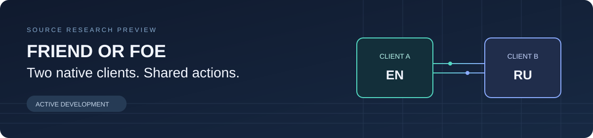

# Spider-Man: Friend or Foe — co-op research

Two friends, two Windows game instances, and an independent English or Russian language choice on each PC. This project connects the game's native two-player controls through a synchronized input stream.

**Beta · active development.** Player builds are on the [Releases](https://github.com/IlkinQafarov/spider-man-friend-or-foe-online/releases) page (the newest is v1.0.0-beta; expect some bugs). No game files or Steam libraries are distributed here: you need your own copy of the game. The launcher's play mode uses the native campaign route; the bounded Tokyo scenario remains for automated connection checks.

## Current state (2026-10-25, v1.0.0-beta)

The campaign route runs end to end in automated tests: New Game or Continue on the host, the Helicarrier hub, the mission computer, missions and the return to the hub. A test runner that shortens each mission to its ending played **the whole campaign, all 20 missions, in one co-op run** (60,000 frames, Tokyo 1 to the final Venom fight), with all seven bosses (Doc Ock, Green Goblin, Sandman, Scorpion, Rhino, Mysterio, Venom); level exits, boss intro cutscenes, results screens and the recorded progress were identical on both games after every mission. Most regions were also checked over a simulated bad connection (240 ms round trip, jitter, a 600 ms freeze every 10 s). Two crashes that are in the game's own code are repaired at start-up by the add-on, only when the exact broken bytes are present: Mysterio's laser (its code was overwritten by an old no-CD loader stub in this Game.exe build) and an empty draw-list entry in Transylvania 3.

- **Launcher:** two big buttons, HOST and JOIN, in 11 languages. HOST opens the host's game and the lobby; the friend pastes the code and clicks JOIN, and their game opens and connects by itself. Import ("Locate game install") links the game files instead of copying them.
- **Two ways in, chosen automatically:** if the friend joins while the host is still in the main menu, both start together and watch the opening (the host picks New Game). If the host picks Continue or is already playing, the friend's game catches up and appears next to the host in the Helicarrier. A friend who leaves can rejoin there.
- **Player 2:** the friend plays the campaign's chosen sidekick and can pick another unlocked one at the sidekick computer. In a mission, either player holds TAB for half a second to swap characters.
- **Cutscenes:** each player may skip or watch; the one ahead waits with a "Waiting for your partner…" box until the other catches up.
- **Settings:** Audio Settings are also in the main menu's Options; keyboard players start with the game's Laptop controls layout; the game's settings are kept between launches. The game runs at 60 frames per second, alone and in co-op.

All of this was checked with bots on one PC with a mock Steam relay. Players have finished the first Tokyo mission together on two PCs over real Steam; the later missions so far only ran with bots (shortened to their endings). Real controllers and shared saves remain untested.

## What has been demonstrated

Current **scenario 11 / wire protocol 3** passed two English/Russian gates: **7,200 ticks with three fixture-driven area transitions**, and **3,600 ticks with native pause/resume**. Both used keyboard/controller fixtures, jitter and a mock Steam relay. All consecutive selected-state samples matched; games, launchers and relays exited 0 without timeout or forced cleanup. Each relay sent/received 921,808 bytes in the transition gate and 461,008 in the pause gate, with zero discarded bytes. These remain bounded same-machine tests.

On **scenario version 5**, two separate English/Russian game processes completed a bounded **7,200-tick** automated gate with keyboard/controller input fixtures, injected timing jitter, a mock Steam relay and **three fixture-driven area swaps**. Selected state checks matched, all owned game/launcher/relay processes exited normally, and each relay sent and received 921,808 bytes with zero discarded bytes. This is historical evidence for that scenario, not a pass for the current source.

A separate **scenario-5** check reached **361 ticks** on the unlimited real-input code path, with input fixtures disabled and quiet diagnostics enabled. Closing only the owned host window delivered an ordered stop to the peer; both sides exited normally. This checks startup and shutdown wiring. It does not establish physical keyboard/controller usability.

Actual two-PC Steam delivery, ordinary campaign transitions and menus, save/resume, reconnect and complete world-state coverage remain unverified. A Steam lobby create/leave smoke check passed, but carried no game traffic. See the [evidence and limits](docs/STATUS.md) before interpreting any pass.

Current source has broader area, progress and mode checks, bounded native keyboard-name lookup and canonical internal key names. Own-code key-name/mode/progress/profile fixtures pass. Recent failed gates, corrections and their limits are recorded in [Status](docs/STATUS.md#current-source-and-recent-failures).

Earlier **run 033** failed on both clients during native startup, before gameplay. The guarded scenario-11 runs passed; the original trigger remains unconfirmed. Current internal naming requires an already-loaded standard US keyboard layout, preserves native display labels and changes no Windows settings. Other layouts and physical input usability need further validation. See [Status](docs/STATUS.md#current-source-and-recent-failures).

## How far along?

**About 85 / 100 toward a first playable release** (updated 2026-10-25, v1.0.0-beta). This is an engineering judgement about milestones, not a measured coverage percentage or a delivery date.

What works in automated tests (bots, one PC, mock Steam relay):

- The campaign route end to end: New Game or Continue, the Helicarrier, the mission computer, missions and the return to the Helicarrier.
- The whole campaign (20 missions, 7 bosses) shortened to each mission's ending, in sync in one run; most regions also over a simulated bad connection.
- Starting together from the main menu (both watch the opening) or joining the host in the Helicarrier; a friend who leaves can rejoin.
- Picking the friend's sidekick, swapping characters with TAB, native pause, cutscenes skipped at different times.
- A player launcher in 11 languages with HOST / JOIN, published as alpha and beta releases; game settings are kept between launches.

What is still missing before a first playable release:

- Whole missions played start to finish by real players on two PCs (so far: the first Tokyo mission).
- Saving the shared campaign from both sides, real controllers, and reconnecting in the middle of a mission.

The [score breakdown](docs/STATUS.md#progress-estimate) and [roadmap](docs/ROADMAP.md) explain what remains.

## Explore the source

| Component | Purpose |
| --- | --- |
| [`probe/`](probe/README.md) | Exact-build x86 hooks, guarded launch, local player routing and input lockstep |
| [`steam/native/`](steam/native/README.md) | Standalone x64 relay; explicit Steam API loading and a loopback game stream |
| [`steam/`](steam/README.md) | Python reference relay and own-code API/transport fixtures |
| [`launcher/`](launcher/README.md) | Windows host/join UI, verified content import and owned-process cleanup |
| [`compatibility/`](compatibility/README.md) | File-hash preflight for the known English and Russian packs |
| [`qa/`](qa/README.md) | Bounded paired-game gates and strict result scoring |

Start with [Building](docs/BUILDING.md), [Testing](docs/TESTING.md) and the [Architecture](docs/ARCHITECTURE.md). Build prerequisites are developer tools; the intended packaged launcher/relay do not require Python. Packaging is not a release-readiness claim.

## Compatibility

The only studied target is the Windows x86 `Game.exe`, version **1.0.0.111**, SHA-256:

```text
ebd30047d7e58c95bf7dc4bd1fb4a5780e16aa472b61c25a8c421632662083db
```

Other executables and unknown translations are unsupported. The engine's exact identity is not verified; this project does not claim generic engine compatibility. Use your own game copy. Import and testing operate on new copies and isolated session directories, preserving original installs and saves.

## Project context and license

Work began through [coop-anything claim #71](https://github.com/cranebeaker/coop-anything/issues/71). Development is continuing. Useful contributions include reproducible test cases, bounded sync oracles, campaign state mapping and portability fixes. Keep game assets, saves, raw runtime logs, account data and personal paths out of contributions.

Original project code and documentation use the [MIT license](LICENSE). That license does not cover the game, its assets, trademarks or third-party libraries. This is an independent fan research project, unaffiliated with the game's rights holders or Valve.
