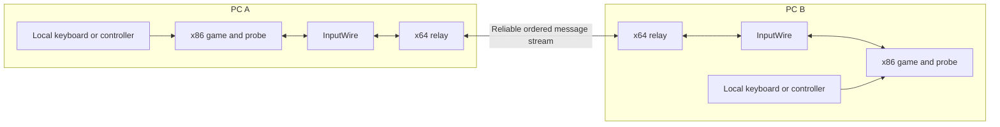

# Architecture

Each participant runs a complete native Windows game instance. The prototype exchanges game actions and checks selected state rather than streaming video or transmitting a whole world snapshot.

The remote Steam edge is the intended deployment path. Historical scenario-5 gates and the current scenario-10 pause/combat gate used separate processes on one machine and an own mock relay. Actual two-PC Steam game traffic remains unverified.

## Content and startup

`compatibility/` validates shared runtime files and a coherent known English or Russian language pack. Both languages use the same studied executable and shared gameplay files. The handshake compares the common content/build and scenario identity; locale-specific text, fonts, dialogue and movies stay local.

`launcher/` verifies/imports a copy, owns its child processes, creates a new session directory and waits for a validated peer-ready event before starting the game. `probe/launcher.cpp` starts only the exact supported executable, installs the probe before original game entry and requires the expected hooks. Observed file/registry writes are redirected or restricted to the test/session paths. This is targeted instrumentation, not a kernel security sandbox.

## Input lockstep

`probe/input_wire.*` carries sequenced action frames, build/scenario digests and selected state hashes. The current research mode uses 60 Hz gameplay steps and a three-frame input delay. Local native bindings convert keyboard/controller state to 28 normalized action values; local/remote roles route these to the two native player slots. Game menus and every event outside that gameplay boundary are not yet fully synchronized.

The probe also controls selected timing and random-number behavior needed by the studied scenario. Current scenario 10 includes the full area-path descriptor, selected player/world observations, campaign flags and progress, and canonical native mode state. Actual mode is always sampled; previous mode is retained only in pause/NIS modes 1/5, and owner only while paused. Mode ranges are checked before sampling. Inactive history, internal padding, local settings and date/time are omitted. Fixture-only pause assertions end at tick 430; continuous mode/world/progress checks run every tick. These choices reduce false mismatches but leave an incomplete oracle: equal samples do not prove complete world equality.

The profile-storage module has passed 39 synthetic tests. It remains an unintegrated foundation, not shared game save/resume.

## Transport and shutdown

`steam/relay.py` is the reference adapter; `steam/native/` supplies a standalone x64 Windows implementation. Both bridge one loopback TCP stream to reliable ordered channel-0 messages with `FOF1` framing, byte offsets, bounded buffers, lobby metadata/member checks and close/ack handling. Live loading requires an explicit existing DLL path and SHA-256. Own API and in-memory fixtures do not load Valve's library or use an account.

Finite gameplay tests use a completion exchange. Ordinary user exit uses a distinct ordered STOP; a broken connection remains an error. The GUI requests close only for its retained owned game, then requests relay STOP on stdin. Process/job handles limit cleanup to children owned by that session. Reconnect, migration and late join are not implemented.

## Verification boundary

`qa/run_pair.py` prepares bounded pairs and invokes the strict scorer in `analysis/native/score_pair.py`. Content preflight happens first. The QA lane lease then covers the first launch through owned-process cleanup; scoring follows lease release. The scorer distinguishes actual game exits from launcher exits, ordinary completion from timeout, and selected-state agreement from full campaign correctness. `qa/prepare_publication.py` separately prepares an audited source-only snapshot without uploading or copying Git history. [Status](STATUS.md) records the tested scope; [Roadmap](ROADMAP.md) covers the missing layers.
